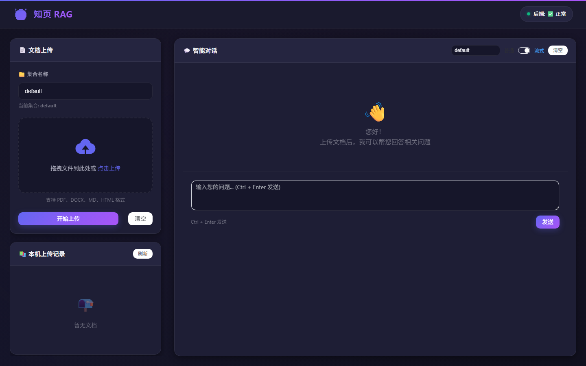

# 知页 RAG

**从文档中查找知识，让回答有据可查。**

知页 RAG（`zhiye-rag`）是一个面向本地使用的文档知识库问答项目。上传 PDF、Word、Markdown 或 HTML 文档后，系统解析和分块文本，使用本地嵌入模型建立向量索引，再将检索到的内容交给大语言模型生成回答。



## 能做什么

- **文档处理**：解析 `.pdf`、`.docx`、`.md`、`.html`，进行文本清理、分块及表格处理。
- **知识库检索**：使用 BAAI/bge-small-zh-v1.5 生成向量，ChromaDB 按集合保存和检索内容。
- **文档问答**：支持智谱和通义千问的兼容接口；普通问答返回来源片段，流式问答逐段显示文字。
- **上传去重**：根据文件内容和目标集合确认完整入库，失败后可重试，同一文件可加入不同集合。
- **浏览器界面**：FastAPI 直接提供 Vue 3 + Element Plus 页面，无需单独启动前端构建服务。

实现重点是连接解析、分块、嵌入、检索和回答这条处理链路，并处理配置缺失、部分入库失败和重复上传等边界情况。项目使用现有嵌入模型和模型 API，不包含自行训练的大模型。

```text
文档 → 解析与清理 → 文本分块 → 本地嵌入模型 → ChromaDB
问题 → 向量检索 → 相关片段 + 问题 → 模型 API → 回答
```

## 快速开始

以下命令均在项目根目录执行。建议使用 Python 3.12；依赖由 `uv.lock` 锁定。

### 1. 安装依赖

```bash
python -m pip install uv
uv sync --locked
```

首次安装包含 PyTorch、Sentence Transformers 和 Docling，依赖体积较大。Windows/Linux 的锁定配置使用 PyTorch CUDA 12.6 软件包，但默认推理设备为 CPU；使用 CUDA 前需要兼容的 NVIDIA GPU 和驱动。

### 2. 配置模型

复制配置示例，**已有 `.env` 时不要覆盖**。

Windows PowerShell：

```powershell
Copy-Item .env.example .env
```

macOS / Linux：

```bash
cp .env.example .env
```

在 `.env` 中填写一个服务商的 API Key：

- 智谱：填写 `ZHIPU_API_KEY`，使用 `DEFAULT_MODEL=zhipu`。
- 通义千问：填写 `DASHSCOPE_API_KEY`，使用 `DEFAULT_MODEL=qwen`。

示例中的模型名可按账号实际可用模型调整。API Key 只放在服务端 `.env` 中；`.env.example` 始终保持空密钥。

首次解析 PDF 或加载嵌入模型可能下载模型文件，需要网络。配置示例默认使用 `EMBEDDING_DEVICE=cpu`，并允许首次下载；只有在缓存准备好后才将离线开关设为 `1`。页面使用固定版本的 CDN 资源，也需要网络。

### 3. 启动

```bash
uv run --locked uvicorn src.api.main:app --host 127.0.0.1 --port 8000
```

打开：

- 页面：<http://127.0.0.1:8000/>
- API 文档：<http://127.0.0.1:8000/docs>
- 健康检查：<http://127.0.0.1:8000/api/health/>

页面与接口使用同源地址。请通过上面的 HTTP 地址访问页面，不要直接双击 HTML 文件。开发时可以在启动命令末尾添加 `--reload`。

### 4. 做一次小型演示

1. 在页面中设置知识库名称，例如 `demo_notes`。
2. 上传仓库中的 `tests/fixtures/sample.md`，等待提示成功入库。
3. 提问“这个示例中的文档处理流程是什么？”。界面使用 `.env` 配置的默认服务商；修改配置后重启服务。
4. 使用普通问答查看来源片段，或切换流式输出观察逐段生成。

上传记录保存在当前浏览器的 localStorage 中，用于本机展示；它不是服务器端的完整文档目录。

## 配置

完整变量见 [`.env.example`](.env.example)。常用项：

| 变量 | 默认值 | 用途 |
| --- | --- | --- |
| `DEFAULT_MODEL` | `zhipu` | 请求未指定服务商时使用的模型服务 |
| `EMBEDDING_DEVICE` | `cpu` | 嵌入模型推理设备 |
| `EMBEDDING_CACHE_DIR` | `./models/cache` | 嵌入模型缓存 |
| `CHROMA_DB_PATH` | `./data/chroma_db` | 向量数据库目录 |
| `UPLOAD_DIR` | `data/uploads` | 原始上传文件目录 |
| `MAX_FILE_SIZE_MB` | `150` | 单文件大小上限（MiB） |
| `SEARCH_TOP_K` | `3` | 检索片段数 |
| `ENABLE_SEARCH_CACHE` | `false` | 是否缓存检索结果；成功入库后失效 |
| `SEARCH_CACHE_TTL` | `300` | 检索缓存有效期，秒 |
| `SEARCH_CACHE_MAX_SIZE` | `100` | 每个缓存服务的最大条目数 |
| `CORS_ORIGINS` | 空 | 独立前端允许的来源，以逗号分隔 |

如需使用独立前端，在加载 `js/api/base.js` 前设置 `window.API_BASE_URL` 为后端 HTTP(S) 地址，并相应配置 `CORS_ORIGINS`。默认同源模式无需设置。

## API

| 方法 | 路径 | 行为 |
| --- | --- | --- |
| POST | `/api/document/upload` | 上传并解析；提供 `collection_name` 才写入知识库 |
| POST | `/api/document/parse-path` | 仅解析上传目录内的受支持文件 |
| GET | `/api/document/supported-formats` | 返回支持的格式 |
| POST | `/api/chat/` | 返回回答、来源片段及用量 |
| POST | `/api/chat/stream` | 返回 UTF-8 纯文本流 |
| GET | `/api/health/` | 返回服务健康状态，不验证模型连接 |

接口字段和请求示例以运行后的 `/docs` 为准。

## 测试

安装完整依赖后运行：

```bash
uv run --locked pytest
```

默认测试不会读取开发者的 `.env`，不会调用真实模型 API、下载嵌入模型或运行 PDF/OCR 模型。文档存储测试使用内存替身；真实 Chroma 测试使用临时目录，不操作现有知识库。

仅检查代码而不安装大模型运行环境时，可以创建独立环境：

```bash
uv venv --python 3.12 .venv-check
uv pip install --python .venv-check -r requirements-test.txt
uv run --no-project --python .venv-check python -m pytest
```

轻量环境未安装 Chroma 时，对应集成测试会明确跳过。前端逻辑测试使用 Node.js 内置测试工具，无需安装 npm 包：

```bash
node --test tests/frontend.test.cjs
```

真实资源测试需要显式开启；API 密钥通过当前进程的环境变量传入，测试不会自动加载 `.env`：

```bash
uv run --locked pytest -m external_api --run-external-api
uv run --locked pytest -m local_model --run-local-model
# PDF 测试还需设置 TEST_PDF_PATH，指向你有权使用的 PDF
uv run --locked pytest -m pdf_model --run-pdf-model
```

仓库附带 GitHub Actions 工作流，执行轻量 Python 测试和前端测试，不需要配置模型密钥。

## 目录

```text
src/api/          接口、配置与依赖管理
src/parsers/      文档解析、文本清理与分块
src/embeddings/   嵌入模型与向量存储接口
src/database/     文档入库与检索
src/retrieval/    检索配置与缓存
src/llm/          模型调用与回答生成
frontend/         页面、样式与浏览器逻辑
tests/            单元测试、集成测试及小型自编样例
```

`data/`、`models/`、`.env` 是本地运行内容，已由 `.gitignore` 排除。旧开发目录中的工程资料、世界银行年报、解析输出和第三方示例不会作为本仓库测试资料发布。运行时会自动创建所需的数据目录。

## 已知限制

- 当前面向单人本地演示，未实现用户登录、访问控制、限流或多租户隔离；不应直接作为公网多用户服务使用。
- 文档和检索索引保存在本机；问答时，问题和选中的相关片段会发送给所选模型服务商。
- 浏览器记录不支持服务端文档管理、跨浏览器同步或文档删除。
- PDF/OCR 效果取决于文档版式和模型；生成回答也可能不准确，需要结合来源核对。
- 流式接口目前只返回正文；来源片段通过普通问答接口返回。
- 从旧开发版本升级时，分块 ID 规则已变化。建议设置一个新的 `CHROMA_DB_PATH` 并重新上传需要的文档，避免新旧索引重复；原始资料和旧数据库可以保留作为备份。

## 基础组件与许可

本项目使用 FastAPI、Vue、Element Plus、ChromaDB、Sentence Transformers、BAAI/bge-small-zh-v1.5、Docling、python-docx 和 OpenAI Python SDK；生成模型由智谱或通义千问提供。第三方名称和署名保留其真实来源。

本项目代码采用 [MIT License](LICENSE)，版权署名为 Zhiye RAG contributors。第三方库、模型和文档的许可独立于本项目；本地测试资料不作为源码的一部分发布。
